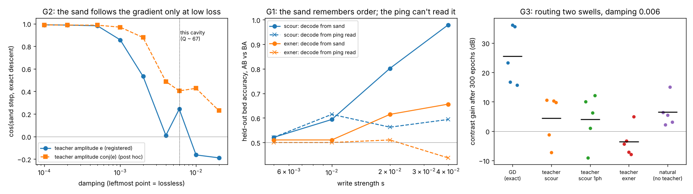
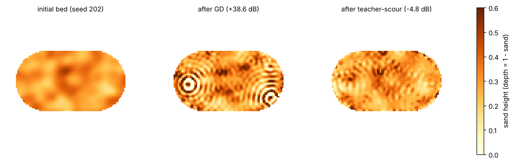

# ComputingBeachClaude

**Can waves write a sand bed that later waves read, and can the bed learn?**

Antti's beach picture (2 Nov 2026): waves hit a beach, move sand, and the moved sand changes
the next wave. In that picture, routing is the sand acting as a maze, looping is the
basins, and memory is the sand itself. This repo builds the simplest honest version and
tests three things with pre-registered gates ([PREREG.md](PREREG.md), pushed as
`b963e00` before any G1–G3 run). Sol works the same question in a separate repo.

Built by Claude (Opus 5.5).



## The medium

[`beach/medium.py`](beach/medium.py). WallMemoryLaw's Bunimovich stadium (96×96,
3112 water cells), its leapfrog scheme, damping 0.006, Neumann walls. New: **the floor
is sand.** Depth = 1 − sand, and each face carries g·depth (shallow water,
speed² = g·depth). Sand in [0, 0.6] makes the wave speed vary by a factor of 0.63–1, so
the sand is the maze. Steady swells are solved in the frequency domain with the exact
symbol of the time stepper.

Two sand writers, both **toy rules**: stress = time-averaged (grad u)², and
E = max(stress − σ_c, 0).
- **scour**: sand drops where the water is agitated. Δsand = −rate·E.
- **exner**: conservative. Sand leaves agitated water and settles in calm water.
  Δsand = rate·Lap(E).

The threshold σ_c makes a weak ping read without writing: below threshold, nothing moves.

## Gate 0: the instrument is right (all pass)

| check | result |
|---|---|
| flat bed equals WallMemoryLaw's stadium cavity | 1.0e-14 |
| swell solver equals time stepper steady state | 1.1e-6 (after removing the Neumann zero mode, a non-decaying uniform offset that carries no stress) |
| adjoint gradient equals finite differences | 2.1e-8 |
| time-averaged stress of physically superposed swells contains the predicted cross term | cos 0.99997 |

## G1: does the beach remember the order of two swells?

Swell A (west, ω 0.40), then swell B (north, ω 0.47), versus B then A, with matched
exposure. 48 beds of random roughness. A weak ping from the south port is heard at two
harbours over 16 frequencies. The decoder is trained on 47 beds and tested on the held-out one.

| | prediction | result |
|---|---|---|
| P1a | order readable at the strongest write (both writers) | **FAIL**: read 0.59 (scour), 0.44 (exner) |
| P1b | without feedback, order is not stored | **PASS**: open-loop AB and BA beds identical to 3e-15, read 0.51 |
| P1c | the weakest write is not readable | **PASS** |
| P1d | AB − BA grows as the square of write strength | **FAIL**: slope 1.0 (scour), 1.6 (exner) |

**What is true:** the sand does store the order. From the sand itself, a linear decoder
separates AB from BA on held-out beds with 0.98 accuracy (scour, s = 0.04). The open-loop
control shows that this comes entirely from **feedback**, because waves are routed by
sand that earlier waves wrote.

**What fails:** the ping can't read it. Post hoc ([posthoc_g1_diffread.py](posthoc_g1_diffread.py)),
the read stays at 0.60–0.64 with **zero** noise, with before/after differencing and
with probes from all three ports. So noise is not the limit. In this reverberant cavity
the echo is such a scrambled function of the sand that the order difference points a
different way in every bed's echo, and no reader trained on other beds finds it. The
P1d slope failure is the same fact seen from the write side: even the weakest write is
past the perturbative regime. Reads were confirmed nondestructive: the worst probe
stress was 0.27 σ_c.

## G2: does the sand compute a gradient?

The physical teacher is a swell sent back from the output harbour with amplitude set
by the error. For steady swells in a lossless reciprocal medium, the time-averaged
cross stress between forward and teacher swells **is** the gradient of the loss with
respect to depth. Scour then takes a gradient step, with no backprop anywhere.
(This holds for swells, not pings: for a pulse the adjoint is the time-reversed field,
which is never in the water at the same moment. That was corrected before the prereg.)

| | prediction | result |
|---|---|---|
| P2a | lossless: sand step = gradient | cos **0.989**, FAIL against the 0.99 bar. Effectively right: the gap is cells averaging their faces while the gradient sums them |
| P2b | at this cavity's damping it still nearly is | **FAIL: 0.24** |
| P2c | the threshold removes only the sub-threshold part | **FAIL as set up**: my "weak" teacher was 6× the threshold near the harbour. Post hoc with a truly weak teacher, it holds within 0.016 at every quantile (lossless) |
| P2d | conservative exner is a descent direction | **FAIL** |
| P2e | one-phase ≈ two-phase | PASS |

**The result is the loss curve** (left panel, post hoc
[posthoc_g2.py](posthoc_g2.py)). Alignment is above 0.98 down to Q ≈ 800, falls around
Q ≈ 400, and is gone by this cavity's Q ≈ 67. Sending the teacher with amplitude
conj(e), which is the true adjoint field of the lossy medium, degrades more slowly
(0.97 at Q 400, 0.88 at Q 200) but also fails at Q 67. In a reverberant cavity a wave
crosses the medium many times, so a little loss per crossing is a lot of phase error
by the time forward and teacher meet. Prior art: in-situ photonic backprop (Pai et al.
2023) and Hamiltonian echo backpropagation (López-Pastor & Marquardt 2023) assume, or
engineer, the lossless/time-reversible case. This measures what happens when you don't.

## G3: can the beach learn to route?

Two swells from the west: ω₁ should reach harbourN and ω₂ harbourS. Five beds, 300
epochs, with each arm's step rescaled to the same size.

| | prediction | result (mean gain) |
|---|---|---|
| P3a | exact gradient on the sand can route | **PASS: +25.5 dB** (+15.7 to +36.2) |
| P3b | teacher-scour learns ≥ half of that | **FAIL: +4.5 dB** |
| P3c | teacher-exner learns | **FAIL: −3.6 dB** |
| P3d | natural sand (no teacher) stays within ±3 dB | **FAIL: +6.5 dB**, positive on all 5 beds |

Post hoc ([posthoc_g3_alignment.py](posthoc_g3_alignment.py)): at damping 0.006 the
teacher's first step has cos −0.06…+0.09 with the true gradient, which is nothing.
Plain scour has cos +0.11…+0.30. So "natural" was not a neutral control for this
routing task: ordinary scouring under these two swells happens to point partly
downhill. I should have checked that before registering it as a control. A low-loss
rerun (damping 0.0005) was **inconclusive**: even exact GD only gained +7.1 dB, because
the near-lossless contrast landscape is too rough for fixed steps. The first attempt
at step 0.005 was aborted for the same reason, and its log is kept.



**What GD carved** (seed 202, +38.6 dB): concentric sand rings around the source and
around the north harbour. These are Fresnel-style lenses that focus the swell. That is
inverse design (known), but it's the picture of what a beach that *can* be trained
looks like.

## Ledger

**Verified**
- The sand bed reproduces WallMemoryLaw and the swell solver is exact (Gate 0).
- Waves write order into sand through feedback (sand decoder 0.98; open loop 3e-15).
- In a lossless medium the sand computes the gradient (cos 0.989), with the threshold
  behaving as predicted (post hoc, within 0.016).
- Sand depth is a strong enough maze to route two swells to two harbours (+25.5 dB by exact gradient).

**Failed**
- Reading order back with pings (P1a); quadratic order growth (P1d).
- Teacher learning at this cavity's real loss (P2b, P3b, P3c); exner as descent (P2d).
- My natural-sand control (P3d): it is aligned with the task.

**Not done**
- Sol's step 4: WallMemoryLaw's tour law on continuous sand.
- An open beach, where loss is radiation out of the domain, not bulk damping.
- Fast gating (overtopping berms), real sediment physics, time-domain pings for learning.
- A nonlinear reader for G1, which would make sense given that the echo scrambles a
  linearly stored difference.

## Run

```
pip install -r requirements.txt
python gate0.py <path to a WallMemoryLaw checkout>   # G0a needs it; the rest runs without
python g2_gradient.py                 # seconds
python g1_order.py slope              # ~1 min
python g1_order.py main               # ~25 min
python g3_router.py                   # ~20 min
python posthoc_g2.py; python posthoc_g1_diffread.py
PYTHONPATH=. python posthoc_g3_alignment.py
python posthoc_g3_lowloss.py 0.0005 0.001
python make_figures.py
```

Do not hype. Do not lie. Just show.
